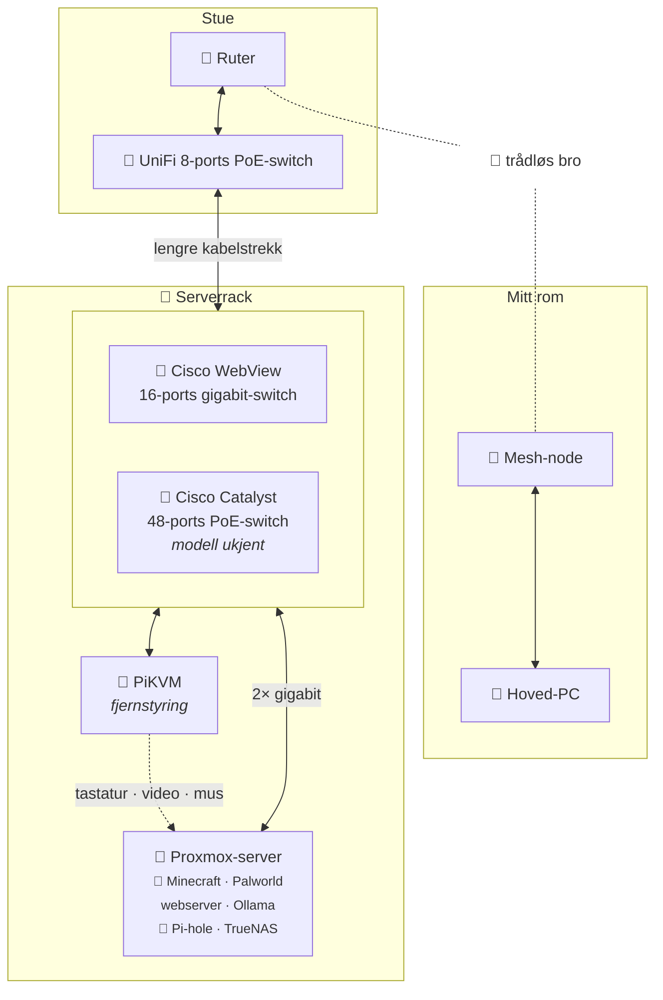

# Nettverkskart for homelaben

Hvordan homelaben er koblet opp, fra ruteren til serveren. Se også **homelab**-prosjektet på nettsiden.



## Tekstversjon

```
  ┌─ Stue ────────────────────────┐                      ┌─ Mitt rom ──────────────┐
  │  Ruter ◄· · · · · · · · · · · │· · trådløs bro · · · │ ·► Mesh-node            │
  │   │                           │                      │    │                    │
  │  UniFi 8-ports PoE-switch     │                      │  Hoved-PC               │
  └───┼───────────────────────────┘                      └─────────────────────────┘
      │
      │  ── lengre kabelstrekk ──
      │
  ┌─ Serverrack ─────────────────────────────────────────┐
  │  Cisco WebView 16-ports gigabit-switch               │
  │  Cisco Catalyst 48-ports PoE-switch (modell ukjent)  │
  │   │                           │                      │
  │   │  2× gigabit               │                      │
  │  Proxmox-server  ◄── KVM ──  PiKVM                   │
  │  Minecraft · Palworld · webserver                    │
  │  Ollama · Pi-hole · TrueNAS                          │
  └──────────────────────────────────────────────────────┘
```

## Enheter

| Enhet | Sone | Rolle |
|---|---|---|
| Ruter | Stue | Internett / gateway |
| UniFi 8-ports PoE-switch | Stue | Switch i stua, opplink til serverracket |
| Mesh-node | Mitt rom | Trådløs bro til ruteren |
| Hoved-PC | Mitt rom | Daglig maskin, koblet til mesh-noden |
| Cisco WebView 16-ports gigabit-switch | Serverrack | Svitsjing |
| Cisco Catalyst 48-ports PoE-switch | Serverrack | Ny. Modell ikke bekreftet |
| Proxmox-server | Serverrack | Hypervisor (se tjenester under). Koblet til med 2× gigabit |
| PiKVM | Serverrack | IP-KVM for «lights out»-administrasjon av Proxmox-serveren |
| APC Smart-UPS | Serverrack | Reservestrøm |

## Tjenester på Proxmox

| Tjeneste | Hva den gjør |
|---|---|
| Minecraft-server | Spillserver |
| Palworld-server | Spillserver |
| Webserver | Hosting |
| Ollama | Kjører store språkmodeller lokalt |
| Pi-hole | Blokkerer reklame og sporere i hele nettverket (DNS) |
| TrueNAS | Nettverkslagring |

## Gjenstår å fylle inn

- [ ] Modellnummer på Cisco Catalyst-switchen.
- [ ] Hvilken switch Proxmox-serveren og PiKVM-en er koblet til, og hvordan de to Cisco-switchene er koblet sammen.
- [ ] Om de to gigabit-koblingene til Proxmox er buntet (LACP) eller separate (for eksempel administrasjon og VM-er).
- [ ] Modell på mesh-systemet, og om hoved-PC-en er kablet til mesh-noden eller på Wi-Fi.
- [ ] VLAN-er / IP-områder, hvis noen.
