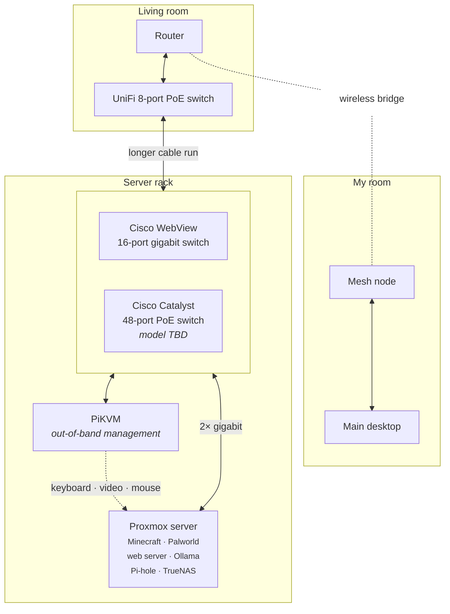

# Homelab network map

How the homelab is wired, from the router to the server. See also the **homelab** project on the site.



## Plain-text version

```
  ┌─ Living room ─────────────────┐                      ┌─ My room ───────────────┐
  │  Router ◄· · · · · · · · · · ·│· · wireless bridge · │ ·► Mesh node            │
  │   │                           │                      │    │                    │
  │  UniFi 8-port PoE switch      │                      │  Main desktop           │
  └───┼───────────────────────────┘                      └─────────────────────────┘
      │
      │  ── longer cable run ──
      │
  ┌─ Server rack ────────────────────────────────────────┐
  │  Cisco WebView 16-port gigabit switch                │
  │  Cisco Catalyst 48-port PoE switch (model TBD)       │
  │   │                           │                      │
  │   │  2× gigabit               │                      │
  │  Proxmox server  ◄── KVM ──  PiKVM                   │
  │  Minecraft · Palworld · web                          │
  │  Ollama · Pi-hole · TrueNAS                          │
  └──────────────────────────────────────────────────────┘
```

## Devices

| Device | Zone | Role |
|---|---|---|
| Router | Living room | Internet / gateway |
| UniFi 8-port PoE switch | Living room | Living room switch, uplink to the server rack |
| Mesh node | My room | Wireless bridge to the router |
| Main desktop | My room | Daily driver, connected to the mesh node |
| Cisco WebView 16-port gigabit switch | Server rack | Switching |
| Cisco Catalyst 48-port PoE switch | Server rack | New. Model to be confirmed |
| Proxmox server | Server rack | Hypervisor (see services below). Connected with 2× gigabit |
| PiKVM | Server rack | IP-KVM for "lights out" management of the Proxmox server |
| APC Smart-UPS | Server rack | Backup power |

## Services on Proxmox

| Service | What it does |
|---|---|
| Minecraft server | Game server |
| Palworld server | Game server |
| Web server | Hosting |
| Ollama | Runs large language models locally |
| Pi-hole | Network-wide ad and tracker blocking (DNS) |
| TrueNAS | Network storage |

## To fill in

- [ ] Cisco Catalyst model number.
- [ ] Which switch the Proxmox server and the PiKVM are plugged into, and how the two Cisco switches connect to each other.
- [ ] Whether the two gigabit links to Proxmox are bonded (LACP) or separate (for example management and VMs).
- [ ] Mesh system model, and whether the main desktop is wired to the mesh node or on Wi-Fi.
- [ ] VLANs / IP ranges, if any.
